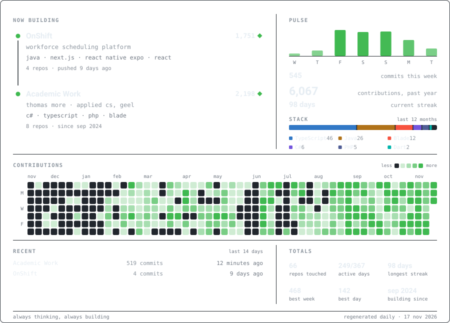

<h1 align="center">Tibo Van Genechten</h1>

  Software engineer &middot; Meerhout, Belgium 
  <a href="https://tibovangenechten.be"><strong>tibovangenechten.be</strong></a>

  <picture>
    <source media="(prefers-color-scheme: dark)" srcset="./profile-card-dark.svg">
    <source media="(prefers-color-scheme: light)" srcset="./profile-card-light.svg">
    
  </picture>

  Most of my work lives in private repositories, so this card counts the work, not the repos. 
  It never publishes commit messages or the names of private repositories &mdash; repository-level counts only. 
  The same numbers as data: <a href="./ship-log.json">ship-log.json</a>, regenerated with the card.

<strong>The same numbers, as text</strong>

<!-- stats:start -->

**6,430** contributions in the past year · **218** this week · **106-day** current streak

| project | commits | repos | stack | activity |
| --- | --: | --: | --- | --- |
| OnShift | 1,751 | 4 | java · next.js · react native expo · react | pushed 3 weeks ago |
| Academic Work | 2,365 | 8 | c# · typescript · php · blade | since sep 2024 |

**Languages** (last 12 months): TypeScript 48% · Java 26% · Blade 11% · C# 6% · PHP 4% · Dart 2%

**Contributions** (2025-11-23 → 2026-11-26): 257 active days of 369 · longest streak **106 days** · busiest week **469** · busiest day **142** · **68** repositories touched · building since sep 2024

**Pushed in the last 14 days**

| project | commits | pushed |
| --- | --: | --- |
| Academic Work | 434 | 5 hours ago |
| private work (49 repos) | 1 | 5 days ago |
| open-playroom | 2 | 7 days ago |

Regenerated daily by <a href="./render.ts">render.ts</a> — last run 2026-11-26. The same numbers as data: <a href="./ship-log.json">ship-log.json</a>.

<!-- stats:end -->

