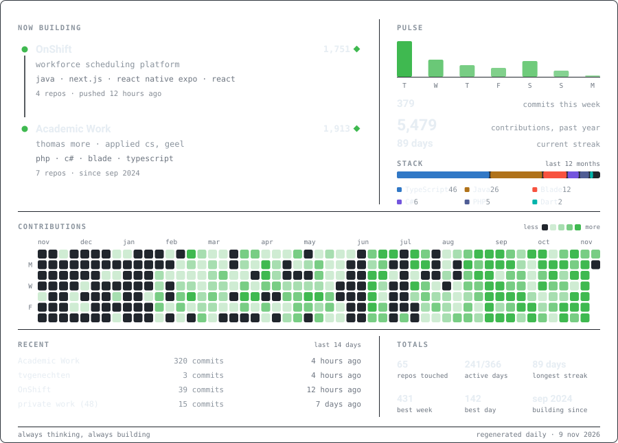

<h1 align="center">Tibo Van Genechten</h1>

  Software engineer &middot; Meerhout, Belgium 
  <a href="https://tibovangenechten.be"><strong>tibovangenechten.be</strong></a>

  <picture>
    <source media="(prefers-color-scheme: dark)" srcset="./profile-card-dark.svg">
    <source media="(prefers-color-scheme: light)" srcset="./profile-card-light.svg">
    
  </picture>

  Most of my work lives in private repositories, so this card counts the work, not the repos. 
  It never publishes commit messages or the names of private repositories &mdash; repository-level counts only. 
  The same numbers as data: <a href="./ship-log.json">ship-log.json</a>, regenerated with the card.

<strong>The same numbers, as text</strong>

<!-- stats:start -->

**5,103** contributions in the past year · **251** this week · **83-day** current streak

| project | commits | repos | stack | activity |
| --- | --: | --: | --- | --- |
| OnShift | 1,747 | 4 | java · next.js · react native expo · react | pushed 2 days ago |
| Academic Work | 1,676 | 7 | php · blade · c# · typescript | since sep 2024 |

**Languages** (last 12 months): TypeScript 46% · Java 26% · Blade 12% · C# 6% · PHP 5% · Dart 2%

**Contributions** (2025-11-02 → 2026-11-03): 238 active days of 367 · longest streak **83 days** · busiest week **431** · busiest day **100** · **65** repositories touched · building since sep 2024

**Pushed in the last 14 days**

| project | commits | pushed |
| --- | --: | --- |
| tvgenechten | 6 | 8 hours ago |
| Academic Work | 124 | 17 hours ago |
| private work (48 repos) | 15 | 22 hours ago |
| OnShift | 93 | 2 days ago |

Regenerated daily by <a href="./render.ts">render.ts</a> — last run 2026-11-03. The same numbers as data: <a href="./ship-log.json">ship-log.json</a>.

<!-- stats:end -->

