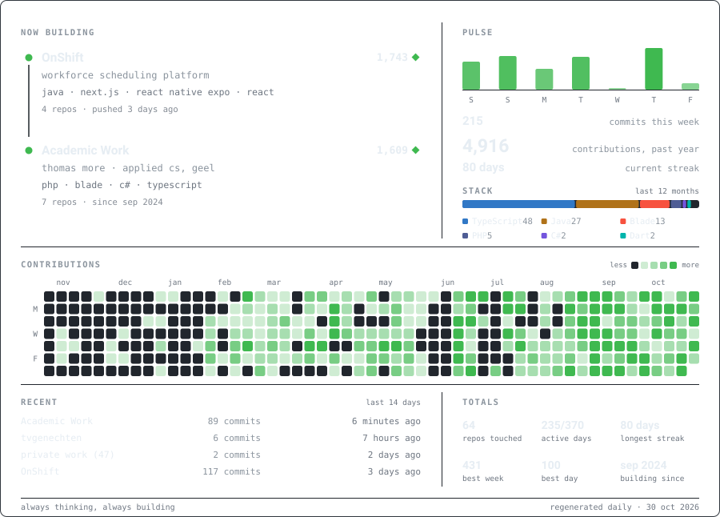

<h1 align="center">Tibo Van Genechten</h1>

  Software engineer &middot; Meerhout, Belgium 
  <a href="https://tibovangenechten.be"><strong>tibovangenechten.be</strong></a>

  <picture>
    <source media="(prefers-color-scheme: dark)" srcset="./profile-card-dark.svg">
    <source media="(prefers-color-scheme: light)" srcset="./profile-card-light.svg">
    
  </picture>

  Most of my work lives in private repositories, so this card counts the work, not the repos.

<strong>The same numbers, as text</strong>

<!-- stats:start -->

**4,660** contributions in the past year · **119** this week · **73-day** current streak

| project | commits | repos | stack | activity |
| --- | --: | --: | --- | --- |
| OnShift | 1,667 | 4 | java · next.js · flutter · supabase | pushed 23 hours ago |
| Academic Work | 1,557 | 7 | php · blade · javascript · c# | since sep 2024 |

**Languages** (last 12 months): TypeScript 48% · Java 26% · Blade 13% · PHP 5% · C# 3% · Dart 2%

Regenerated daily by <a href="./render.ts">render.ts</a> — last run 2026-10-23.

<!-- stats:end -->

